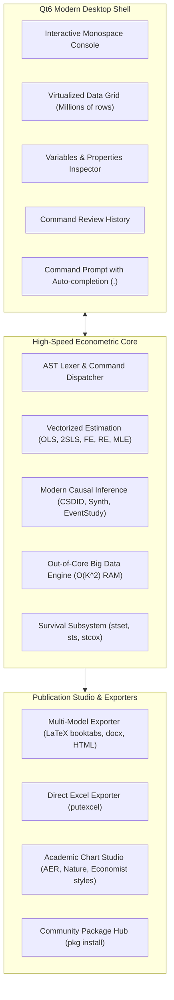

<p align="center">
  <picture>
    <source media="(prefers-color-scheme: dark)" srcset="gui/assets/potatostics-logo-horizontal-dark.png">
    <source media="(prefers-color-scheme: light)" srcset="gui/assets/potatostics-logo-horizontal.png">
    
  </picture>
</p>

<p align="center">
  <b>High-Performance Econometric Software & Statistical Computing Platform</b>
</p>

<p align="center">
  
  <a href="LICENSE"></a>
  
</p>

**Potatostics** is a fast, defensible, open-source statistical analysis and econometric software workstation. Built in Python and backed by high-speed columnar computing libraries (NumPy, SciPy, Polars, PyArrow), Potatostics provides a complete command-line and graphical environment for empirical microeconomics, macro time-series, survival analysis, and modern causal inference.

📖 **Comprehensive Documentation**: Read the complete [User Manual](docs/USER_MANUAL.md) for full syntax tutorials, mathematical specifications, and econometric examples.

---

## 🖥️ Visual Overview & Architecture



---

## 📊 Desktop Interface Layout

```
+-----------------------------------------------------------------------------------------+
| Menu: File  View  Data  Graphics  Statistics  Tools  Help                               |
+--------------------------+--------------------------------------------------------------+
| VARIABLES PANE           | RESULTS CONSOLE / SPREADSHEET TABS                          |
| Filter: [             ]  |                                                              |
| Name     Type   Label    |   . regress price mpg weight, vce(robust)                    |
| price    float  Price    |   --------------------------------------------------------   |
| mpg      int    Mileage  |   Linear regression               Number of obs =       74   |
| weight   int    Weight   |                                   F(2, 71)      =    69.64   |
| foreign  str    Origin   |                                   Prob > F      =   0.0000   |
|                          |                                   R-squared     =   0.2934   |
|                          |                                   Root MSE      =   2452.4   |
|                          |   --------------------------------------------------------   |
|                          |          price |      Coef.   Std. Err.      t   P>|t|       |
|                          |            mpg |   -49.5122    86.1560   -0.57   0.567       |
|                          |         weight |     1.7466     0.6414    2.72   0.008       |
|                          |          _cons |  1946.0687  3597.0496    0.54   0.590       |
+--------------------------+--------------------------------------------------------------+
| COMMAND HISTORY          | COMMAND BAR                                                  |
| 1. use auto.dta          |                                                              |
| 2. summarize price mpg   |   . [ regress price mpg weight, vce(robust)          ] [Run] |
| 3. regress price mpg     |                                                              |
+--------------------------+--------------------------------------------------------------+
```

---

## ⚡ Key Highlights & Capabilities

- **Documented numerical benchmarks**: Selected estimator specifications have reproducible checks with case-specific tolerances and recorded results.
- **Zero Resource Limits**: Uncapped multi-threading across all CPU cores via BLAS/LAPACK and Polars Rayon threads; no artificial RAM or variable limits.
- **Out-of-Core Big Data (`bigregress`)**: Process 100+ GB datasets exceeding physical RAM using online Cholesky factorization in $O(K^2)$ memory space.
- **Modern Causal Inference**:
  - **`csdid`**: Callaway & Sant'Anna (2021) staggered difference-in-differences with multiplier bootstrap.
  - **`synth`**: Synthetic control method with convex quadratic programming and in-space placebo permutations.
  - **`eventstudy`**: Dynamic lead/lag event studies with automatic reference-period omission and pre-trend Wald tests.
  - **`psmatch`**: Propensity score matching with distance caliper thresholds and covariate balance tables.
- **Decentralized Community Package Hub (`pkg`)**: Install and share community-authored Python routines with one command (`pkg install <name_or_url>` / `ssc install <name>`).
- **Academic Chart Studio**: One-click publication figures formatted to the standards of the *American Economic Review*, *Nature*, and *The Economist*.
- **Direct Table Exporters**: Export formatted regression tables to LaTeX (`booktabs`), Microsoft Word (`.docx`), HTML, and Excel (`putexcel`).

---

## Econometric Verification & Benchmarks

The automated benchmark battery covers selected specifications and records the comparison target, sample, tolerances, and evaluated metrics for each case. See the [benchmark report](tests/data/benchmark_results/benchmark_report.md), [machine-readable results](tests/data/benchmark_results/benchmarks.json), and [benchmark runner](engine/benchmarks.py).

Its comparisons include OLS, binary response and count models, quantile regression, IV 2SLS, and panel fixed effects. Analytical checks cover selected survival, time-series, and difference-in-differences results. The seeded DRDID simulation checks recovery under its specified data-generating process. The report identifies checks against a shared implementation, such as statsmodels HP filtering, VAR, ordered logit, and Cox PHReg, as internal consistency. The recorded results apply to the tested samples, estimator variants, and covariance conventions.

The separate [external benchmark tests](tests/test_external_benchmarks.py) include stored target values for the CSDID minimum-wage example and expected donor-weight and fit properties for the Basque synthetic-control example. Live statistical-software reference logs can be supplied using the [reference-log workflow](tests/data/reference_outputs/README.md).

---

## 🚀 Quick Start

### 1. Launching the Desktop Application

Extract the source ZIP from GitHub and open a terminal in the folder containing `pyproject.toml`. With Python 3.10 or newer installed, run the following commands. The first command installs Potatostics and downloads its runtime dependencies.

```bash
python -m pip install .
potatostics
```

### 2. Running Batch Scripts (.do files)
```bash
python main.py --batch analysis.do
```

### 3. Running the Test Suite
```bash
python -m pip install -e '.[dev]'
python -m pytest tests
```

---

## 📖 Command Syntax Reference

### Everyday Data Wrangling
```text
use "data.csv", clear            // Load CSV or binary dataset (.dta, .parquet)
describe                         // Inspect variable names, data types, and labels
summarize price mpg, detail      // Summary statistics with percentiles, skewness, kurtosis
tabulate foreign rep78           // Cross-tabulation table
generate log_income = log(inc)   // Compute mathematical expressions
replace log_income = 0 if inc<=0 // Conditional modification
egen mean_p = mean(price), by(f) // Grouped operations (mean, sd, pctile, std, mode, rank)
save "clean.dta", replace        // Save to binary dataset format
```

### Econometric Estimation
```text
regress price mpg weight, vce(robust)               // Heteroskedasticity-robust OLS
regress price mpg weight, vce(cluster region)       // Finite cluster-adjusted SEs (G/(G-1))
ivregress 2sls lwage exper (educ = nearc4)          // Two-Stage Least Squares IV
estat weakiv                                        // Montiel Olea & Pflueger effective F-statistic
xtset id year                                       // Declare panel identifiers
xtreg y x1 x2, fe                                   // Panel Fixed Effects (within transform)
xtreg y x1 x2, re                                   // Panel Random Effects (Swamy-Arora GLS)
hausman fe_model re_model                           // Specification contrast test
reghdfe y x1 x2, absorb(firm_id year)               // Multi-way high-dimensional fixed effects
nbreg visits age income, irr                        // Negative Binomial count MLE with alpha LR test
stset time, failure(died)                           // Survival analysis setup
sts list                                            // Kaplan-Meier table (Greenwood SE, log-log CI)
stcox age treatment, ties(breslow)                  // Cox Proportional Hazards model
```

### Causal Inference & Exporters
```text
csdid y, ivar(id) time(year) gvar(cohort)           // Callaway & Sant'Anna staggered DiD
synth gdp trade, trunit(1) trperiod(1975)           // Synthetic Control with placebo tests
eventstudy y treated, ivar(id) tvar(year)           // Dynamic event-study with pre-trend test
esttab m1 m2 using "table1.tex", replace booktabs   // Export to LaTeX booktabs
putexcel set "results.xlsx", modify                 // Direct Excel cell reporting
putexcel A1 = ("Analysis Results") B2 = matrix(e(b))
```

### Community Packages & Authoring Plugins
```text
pkg search winsorize                                // Search community catalog
pkg install winsorize                               // Install & hot-load package
plugin new mycommand                                // Scaffold template in user plugins directory
```

---

## 📦 Project Structure

```
potatostics/
├── engine/                   # High-performance econometric and statistical solvers
│   ├── estimation.py         # OLS, IV 2SLS, Panel FE, Random Effects GLS, Survey Linearization
│   ├── advanced_econometrics.py # Count (nbreg), Discrete (mlogit), Survival (stcox, sts), VAR
│   ├── causal_modern.py      # Callaway & Sant'Anna DiD, Synthetic Control, Event Studies
│   ├── data_ops.py           # AST expression evaluator, egen functions, date/string built-ins
│   ├── bigdata.py            # Out-of-core online big data Cholesky streaming & Polars acceleration
│   ├── exporters.py          # LaTeX booktabs, Word docx, HTML, and Markdown exporters
│   ├── plugins_manager.py    # Community package manager and plugin lifecycle engine
│   └── interpreter.py        # Central command dispatcher and do-file execution loop
├── gui_qt/                   # PySide6 Modern High-DPI Desktop Interface
│   ├── main_window.py        # Dockable workspace, menus, and application coordinator
│   ├── console.py            # Formatted monospace statistical console
│   ├── data_grid.py          # Virtualized spreadsheet editor supporting millions of rows
│   ├── package_dialog.py     # Community package manager & plugin template editor GUI
│   └── dialogs.py            # Point-and-click dialog builders
├── docs/                     # Documentation and user guides
│   ├── USER_MANUAL.md        # Comprehensive 15-chapter User Manual
│   └── RELEASE_CHECKLIST.md  # Multi-platform deployment and verification criteria
├── tests/                    # Regression tests and numerical benchmarks
└── main.py                   # Desktop application entry point
```

---

## 🛡️ Security & Independent Implementation

* **Zero Hidden Functions & Zero Telemetry**: Potatostics contains no background telemetry, tracking, phone-home network calls, obfuscated code, or hidden functions. All network activity (such as `pkg install` from the community catalog) is strictly user-initiated, HTTPS-only, and auditable.
* **Independent Implementation**: Potatostics is an independent implementation written entirely from scratch in Python and PySide6, based exclusively on peer-reviewed econometric literature (e.g., Wooldridge, Greene, Cameron & Trivedi, Callaway & Sant'Anna, Brant, Lumley) and public mathematical specifications.
* **No Copyrighted Binary Assets**: No proprietary binaries, decompiled bytecode, or copyrighted software documentation from external vendors are stored in or distributed with this codebase.

---

## 📄 License

Potatostics is free and open-source software, licensed under the **GNU Lesser General Public License v3.0 or later (LGPL-3.0-or-later)**. See the [LICENSE](LICENSE) file for complete details.
